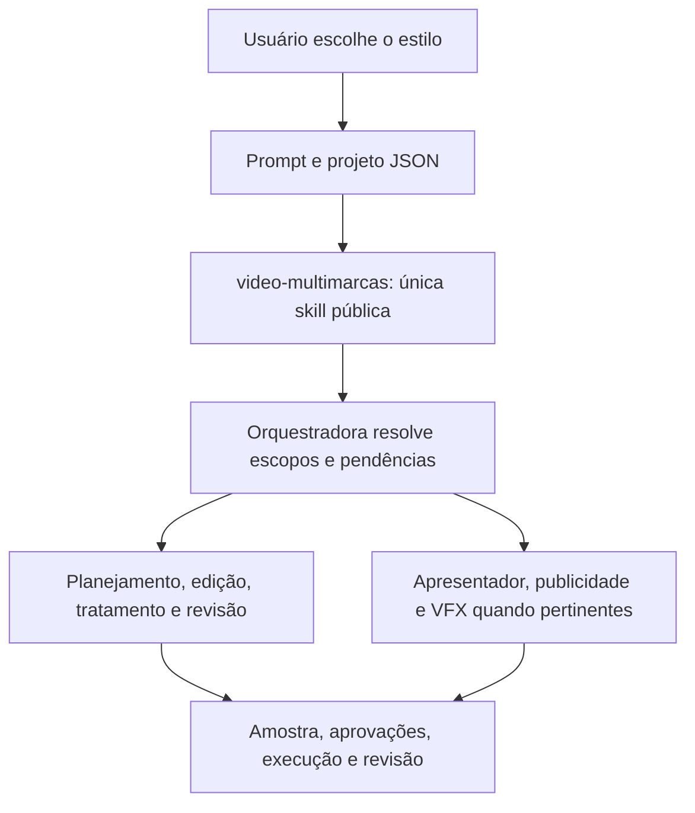

# Uma skill pública, sete módulos internos

O usuário chama somente **video-multimarcas**, mantendo o nome existente. A orquestradora lê estilo, contribuições, escopos, materiais e etapa atual, seleciona os módulos pertinentes e conduz uma única conversa até a entrega possível. Não pede ao usuário que escolha especialistas nem que instale sete skills extras.

## Fontes e carregamento

- `.agents/skills/video-multimarcas/SKILL.md`: única entrada canônica pública.
- `references/skill-modules/<id>.md` dentro dessa skill: sete fontes canônicas internas. Não têm frontmatter de registro de skill.
- `references/skill-modules/<id>/references/` e `templates/`: recursos próprios de cada módulo, quando necessários.
- `.claude/skills/video-multimarcas/SKILL.md`: única ponte de descoberta do Claude Code no checkout.
- `plugins/` e os arquivos ZIP/skill: cópias geradas da única skill completa; nenhum especialista independente é registrado.

O registro do sistema v4 separa `skillSystem.skills` (uma entrada) de `skillSystem.modules` (sete instruções internas). Os IDs existentes em `skillRouting.modules` e `primarySkill` continuam estáveis para compatibilidade com projetos v1/v2/v3; `primarySkill` indica a responsabilidade interna principal, não outra entrada pública.

O runtime calcula a rota pelas contribuições efetivas do contexto validado e lê somente os módulos selecionados, com seus recursos próprios. Paleta/tipografia/som isolados de uma referência VFX não carregam o módulo de composição; máscaras/efeitos pertinentes carregam. Planejamento, edição, tratamento e revisão são responsabilidades de base, não uma ordem de refazer etapas aprovadas. Pedidos locais e novos efeitos na conversa continuam exigindo apenas os módulos e dependências pertinentes.

## Atualização de instalações antigas

O instalador prepara a skill completa antes de substituir arquivos. A lista de árvores de especialistas conhecidas em `packaging/legacy-specialists.json` contém hashes por arquivo de versões anteriores do kit e de suas pontes Claude.

Uma pasta antiga só é retirada automaticamente quando seus arquivos correspondem a uma árvore conhecida. Ela é movida integralmente para `.cache/video-multimarcas-installs/<versão-do-backup>/<agente>/<id>/`. A versão anterior da orquestradora também recebe backup. Se a ativação falhar, o instalador restaura a entrada anterior e os especialistas retirados, e limpa o staging.

Pastas personalizadas, desconhecidas, com arquivos extras ou symlinks são preservadas e aparecem em `preservedLegacy`. Isso pode deixar entradas externas/personalizadas visíveis naquela instalação; o kit continua registrando apenas sua entrada pública. O relatório mostra os caminhos para revisão consciente, sem apagar conteúdo pessoal. A skill externa `vfx-effects`, outras skills e configurações não são modificadas.

O instalador compacto obtém a quantidade pública e os módulos do contrato e confere sua presença no checkout. Atualizar uma instalação existente em outra pasta usa `scripts/install-agent.mjs`; obter uma revisão nova do runtime continua um procedimento separado e não transfere projetos, contas ou mídia.

## Verificações

As regressões verificam uma entrada por agente/plugin, sete módulos com links resolvidos, recursos VFX e tratamento no novo endereço, migração reconhecida para Codex e Claude, preservação de personalizações e da skill externa, rollback após retirar especialistas e carregamento condicional no runtime. A auditoria reproduzível dos 1.425 estilos continua em `npm run audit:prompts`, com o mesmo contrato de contribuições e escopos.

Validação concluída: **232 testes JavaScript + 9 Python**, typecheck e validador. Navegador em 375/1440 px com os dois destinos e a Page embutida; uma entrada por pacote e links Markdown internos resolvidos. [Registro estruturado](validation/single-entry.json).

Essa organização simplifica instalação e encaminhamento. Não instala ferramentas de VFX, não certifica vídeos conceituais e não substitui amostra, playback/escuta e aprovação humana. Preparar pacotes, atualizar a PR, integrar em main, publicar o site e instalar nas contas são ações distintas.
