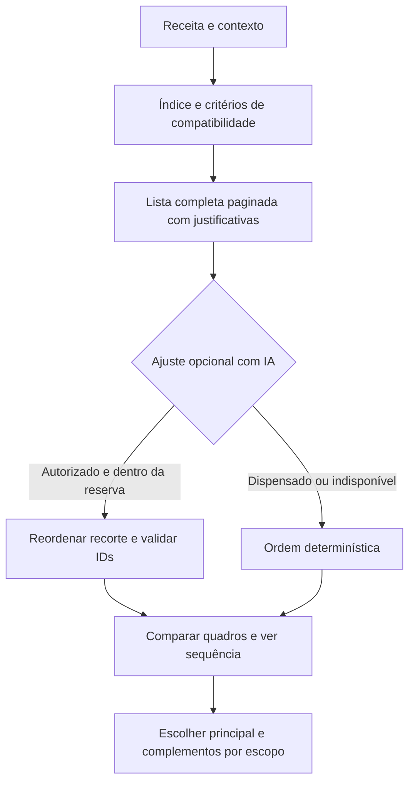
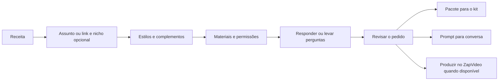
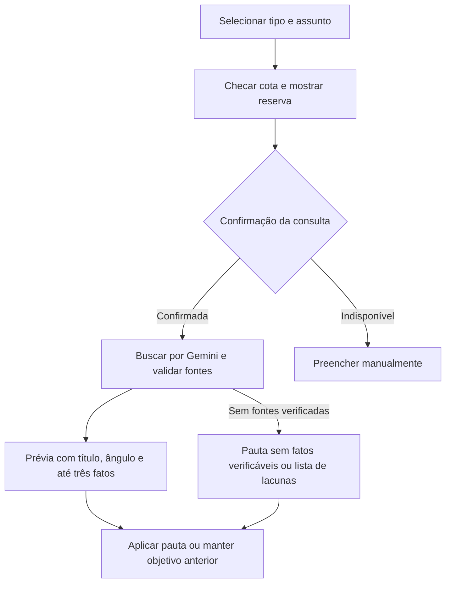
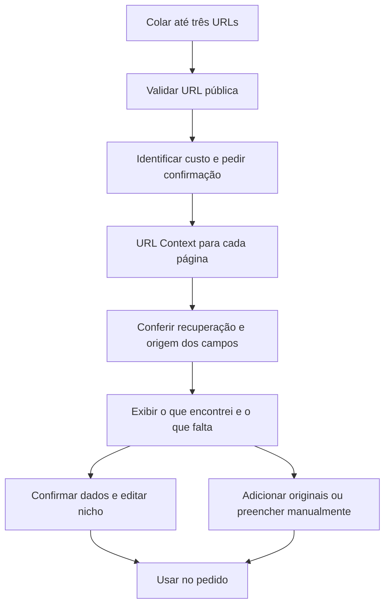
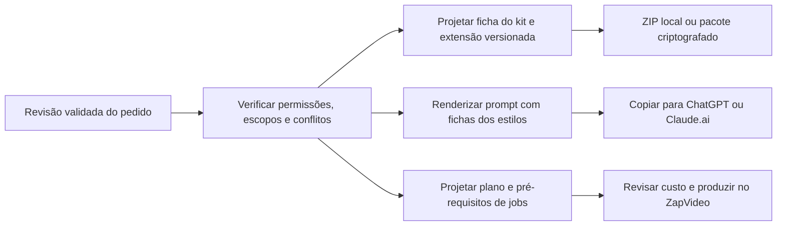
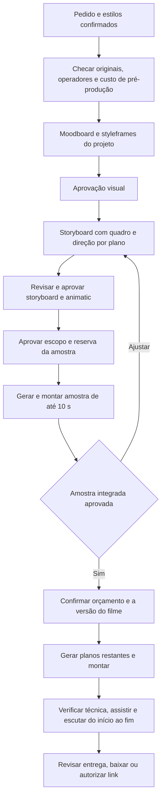

# Unificação de receitas e estilos no ZapVideo

Plano de 24/11/2026. Base do site `8d775f4c`. Fonte do Arsenal `16b63fc0` no branch `docs/arsenal-receitas-fonte`, pasta `docs/arsenal-receitas/`. Nomes de rotas, campos novos, metas e limites indicados abaixo são propostas para implementação e validação.

## 1. Decisões de produto

| Decisão | Resultado |
| --- | --- |
| Quantidade de estilos | Todos os compatíveis e relacionados à receita, com carregamento progressivo. |
| Primeira sugestão | Mesma apresentação das demais. O principal só existe depois da escolha da pessoa. |
| Ordenação | Regras determinísticas, com reordenação opcional pelo Gemini. |
| Orçamento de planejamento | Teto compartilhado do piloto e reserva por chamada. Produção de vídeo tem cotação e autorização próprias. |
| Nicho | Opcional. O link pode sugerir um setor editável. |
| Perguntas | Responder no site ou deixar para a conversa. Respostas registradas seguem junto. |
| Produção hospedada inicial | Vídeo de produto para loja online e Criar vídeo com IA generativa. |
| Acesso à pauta e aos links | Qualquer visitante, inclusive sem conta ou código. |
| Prévias | Stories SVG na receita. Quadros e sequências do catálogo na etapa Estilos. |
| Complementos | Todas as características e os escopos existentes no kit. |
| Destinos de conversa | Incluir o plano completo e apontar a etapa que continua no kit se faltar acesso ao renderizador. |
| Linha GDA | Fora desta versão. Manter o ID reservado para ler projetos antigos. |
| Prioridade | Oito grupos na mesma entrega. Dentro deles, começar a validação pelas receitas mais simples. |
| Métricas | Totais de receita escolhida, estilo aceito ou trocado e saída usada, sem conteúdo pessoal. |

Na primeira experiência, a pessoa escolhe a receita, informa assunto ou link, seleciona o visual e confere o pedido. Materiais e perguntas adicionais aparecem quando mudam a entrega. O visitante pode seguir manualmente se o uso compartilhado atingir o teto. O primeiro ensaio hospedado usa produto com fotos e uso documentado, ou uma cena generativa simples. A escolha comercial é validar tempo até o pedido, conversão e custo por entrega antes de ampliar a automação audiovisual.

## 2. Mapa do existente

| Área | Evidência no repositório | Tratamento no plano |
| --- | --- | --- |
| Entrada e etapas da galeria | `guided-ui.js` conduz Objetivo → Aparência → Materiais → Preparar. `guided.js` implementa `recommend`, `materialPlan` e `recipe`. `app.js` conserva escolha e exporta o pedido. | Estender a jornada existente com seleção de receita, pesquisa e entrega. Compartilhar o estado com o workspace. Manter ponte para URLs e rascunhos antigos. |
| Receitas no workspace | `zapvideo-recipes.mjs` tem 56 receitas em nove grupos, objetivos, estágios, preparo de materiais, mídia de prévia e rotas. `zapvideo-recipe-ui.mjs` monta busca simples e modal. | Completar dados com a fonte normalizada do Arsenal. Reaproveitar seleção e IDs. A prévia integrada passa a usar o componente Stories. |
| Visuais do workspace | `zapvideo-guided.mjs` tem `styles` com três estilos fixos e `recipeStyles` com cinco. `makeBoard` usa temas e tempos fixos por duração. `zapvideo-workspace.mjs` aplica esse atalho ao storyboard e ao briefing. | Tratar os cinco valores como atalhos de compatibilidade. Novas escolhas usam IDs do catálogo e um plano por cena. Referência física, estilo e instrução de cena têm campos próprios. |
| Catálogo e complemento | `catalog.json` v4.8 tem 1.425 estilos, 35.311.566 bytes e 30 entradas em `families`. `presenterCollection.sectors` declara 53 setores de apresentador. O campo `segment` é uma string em parte dos registros e usa outra taxonomia. `style-picker.js` e `workflow.js` já validam características e escopos. | Gerar índice próprio e extrair os 53 setores do conjunto de apresentador com IDs estáveis. Criar cruzamento editorial com outros segmentos. Reaproveitar `combinationPlan` e `referenceManifest`. |
| Busca e materiais | `search.js` do Atlas já indexa termos e aliases. `material-ui.js` trabalha com papéis e disponibilidade do insumo. `production-ui.js` consulta/acompanha a produção vinculada à galeria. `site-ui.js` liga as telas do Atlas. | Extrair funções puras, aproveitar a busca já indexada e consolidar os estados de recebimento e permissão. O executor continua separado da UI do wizard. |
| Pedidos e exportação | `workflow.js` gera `portableBundle`, `exportProject` e `buildPrompt`. `zapvideo-contract.mjs` valida `zapvideo-project` v1. `scripts/video.mjs` envia esse formato ao importador local. Pedidos da galeria chegam a `importSiteRequest`, que recalcula escopos, rota e contexto. `cloud-handoff.js` e `zapvideo-transfer.mjs` usam o pacote criptografado. | Criar um pedido canônico do wizard e adaptadores para as duas famílias de exportação. Preservar leitura das versões antigas e verificar os campos novos no importador atualizado. |
| Worker e mídia | `zapvideo/worker.mjs` serve `/catalog.json` via R2, valida sessão e exportação temporária. Há D1, R2 privado, Workflows e Container FFmpeg. `gemini.mjs` tem briefing, análise e leitura de produto por URL Context. `jobs.mjs` guarda reserva e estado, `clips.mjs` e `assembly.mjs` verificam aprovações separadas. `zapvideo-assembly.mjs` e `zapvideo-captions.mjs` têm contratos reutilizáveis de montagem e legendas. | Estender capacidades de planejamento sem abrir acesso a projetos privados. Reusar a infraestrutura de jobs, upload, orçamento, revisão e entrega. |
| Arsenal | `recipes-1…4` e `RX` fornecem conteúdo por receita. `tools.js` registra 107 ferramentas. `app.js` gera pauta e monta pedido, conflitos e perguntas. `scenes.js` e `styles.css` apresentam cenas em Stories. | Normalizar dados, textos e registro de ferramentas. Portar apenas componentes e regras da UI. Ligações Firecrawl/Claude do protótipo dão lugar aos adaptadores Gemini do Worker. |

Consulte as fontes internas da implementação. [guia ZapVideo](../ZAPVIDEO.md), [guia do fluxo inicial](../GUIDED-START-2.10.md), [sistema de skills](../SKILL-SYSTEM-2.12.md), [contribuições](../../.agents/skills/video-multimarcas/references/style-contributions.md), [mecanismos de apresentador](../../.agents/skills/video-multimarcas/references/presenter-techniques.md), [interação de apresentador](../../.agents/skills/video-multimarcas/references/presenter-interaction.md) e [aprovação visual](../../.agents/skills/video-multimarcas/references/universal-visual-approval.md).

### Lacunas que mudam a arquitetura

- Um estilo curto como `presenter` não identifica `Planta em vidro` nem outro item de catálogo. A migração mantém esse atalho em rascunhos antigos. O usuário confirma qualquer novo ID de estilo antes de perder a escolha original.
- No Arsenal, `PRES_URL` aponta para uma coleção e alguns nomes são descritivos. A âncora deve usar o ID conferido, com versão do catálogo. Por exemplo, `explicador-dados-no-gesto` se chama **Cotas no lugar certo** no catálogo 4.8. A correspondência é de mecanismo e depende de cotas e gesto comprovados. Não converter automaticamente qualquer gráfico falado nesse estilo.
- Tempos e saídas do Arsenal também são propostas. Produto pode pedir dois recortes e 360°. O workspace atual tem uma linha de montagem e uma seleção de duração. O pedido pode guardar dois entregáveis ligados. No site, cotação e aprovação são por cada entrega. Foto única admite enquadramento compatível, sem inventar o verso.
- `recipeCanGenerateClip` e `route` são recursos atuais do editor. A nova elegibilidade de **Produzir no site** deriva da receita, opção de estilo/estágio, insumos, modalidade, provedor acessível e aprovações. Os outros projetos continuam utilizáveis por exportação.
- A prévia SVG explica a sequência. A referência do catálogo indica aparência. A prova de execução vem de uma amostra revista em movimento e com som. `readiness` e `proof` de referência não viram aprovação.
- O HTML do Arsenal é uma referência de design. Os textos de marketing em `why` podem explicar a intenção, mas números de engajamento e alegações sem fonte ficam fora da UI até terem evidência. Ferramentas indicadas no registro não implicam instalação, conexão ou compatibilidade.

## 3. Objetos de dados propostos

Tipos ilustrativos abaixo. O esquema de transporte será fechado, versionado e validado em navegador, Worker e importador. `StyleAspect`, `StyleScope` e `StyleContribution` vêm do contrato vigente de `workflow.js`. Campos inferidos não entram como dados confirmados. Base do catálogo, tabela de materiais e escolhas são fixados na revisão.

```ts
type ID = string
type HTTPS = string
type DateISO = string
type CurrencyValue = { currency: 'BRL' | 'USD'; minor: number }
type Format = '9:16' | '16:9' | '1:1' | '4:5'
type Slot = {
  key: ID; label: string; type: 'text' | 'duration' | 'format' | 'money' | 'public-url' | 'choice'
  required: boolean; choices?: { id: ID; label: string }[]; example?: string
}
type StyleQuery = {
  families?: ID[]; kinds?: string[]; anyFlags?: ('presenterEditing' | 'advertising')[]
  sectors?: ID[]; exactMechanisms?: ID[]; exclude?: ID[]; anchors?: ID[]
  requiresCoverage?: ID[]
}
type MaterialNeed = {
  id: ID; type: 'photo' | 'video' | 'audio' | 'screen' | 'data' | 'diagram' | 'brand' | 'copy'
  label: string; requiredFor: ('planning' | 'sample' | 'final')[]
  purpose: string; alternatives?: ID[]; permission: 'confirm-use' | 'confirm-image-voice' | 'verify-source'
}
type Recipe = {
  schemaVersion: 1; id: ID; sourceId: ID; catalogRevision: string; groupId: ID
  title: string; description: string; intentions: ID[]; complexity: 'simple' | 'medium' | 'advanced'
  objectiveTemplate: string; slots: Slot[]
  steps: [RecipeStep, RecipeStep, RecipeStep]
  inputs: MaterialNeed[]; questions: ID[]; tools: ID[]
  styleQuery: StyleQuery; why: string
  references: { styleId?: ID; url?: HTTPS; label: string }[]
  availableOutputs: ('kit' | 'chat' | 'web-video')[]
}
type RecipeStep = { sceneId: ID; caption: string; purpose: string; toolIds: ID[] }

type StyleSelection = {
  catalogVersion: string; catalogSha256: string
  principal: StyleChoice | null; complements: StyleChoice[]
}
type StyleChoice = {
  styleId: ID; origin: 'rules' | 'gemini' | 'user'; reason: string
  accepted: 'user'; contributions: { aspect: StyleAspect; scope: StyleScope }[]
}
type StyleCandidate = {
  styleId: ID; origin: 'rules' | 'gemini'; reason: string
  compatibility: 'ready-to-plan' | 'needs-input'; missing: ID[]
}

type PautaPurpose = 'noticia' | 'produto' | 'alta' | 'lancamento' | 'ferramenta' | 'duvidas'
type PautaRequest = {
  projectId?: ID; revision: number; recipeId: ID; purpose: PautaPurpose; subject: string;
  sector?: ID; linkExtractionIds?: ID[]
}
type PautaResult = {
  query: string; window?: { from: DateISO; to: DateISO }; generatedAt: DateISO
  title: string; angle: string; objective: string
  sources: { id: ID; url: HTTPS; title: string; publishedAt?: DateISO; checkedAt: DateISO }[]
  facts: { text: string; sourceIds: ID[] }[] // até três com pelo menos uma fonte cada
  status: 'with-sources' | 'without-sources' | 'insufficient'
}
type Extracted<T> = { value: T; sourceUrl: HTTPS; observedAt: DateISO }
type LinkExtraction = {
  id: ID; url: HTTPS; kind: 'product' | 'store' | 'site'; status: 'partial' | 'available' | 'unavailable'
  title?: Extracted<string>; description?: Extracted<string>; price?: Extracted<CurrencyValue>
  variations: Extracted<{ label: string; value: string }>[]
  reviews: Extracted<{ score?: number; count?: number; theme?: string }>[]
  visuals: { mediaId: ID; kind: 'image' | 'video' | 'logo'; url: HTTPS; sourceUrl: HTTPS
             use: 'reference-only' | 'awaiting-rights' | 'authorized'; rightsEvidenceId?: ID }[]
  colors: Extracted<{ hex: string; role?: string }>[]
  proposedSector?: { id: ID; reason: string }; missing: ID[]
}
type ToolRegistry = {
  version: 1; entries: Record<ID,{
    label: string; kind: 'skill' | 'module' | 'plugin' | 'mcp' | 'local' | 'service'
    skillCommand?: string; capability: ID; candidatesFor: ('codex' | 'claude-code' | 'claude-ai' | 'chatgpt' | 'web')[]
    access: 'verify' | 'requires-account' | 'requires-runtime'; usageMayCost: boolean
    role: ID; notes?: string
  }>
}
type ConflictRule = {
  id: ID; allOf?: ID[]; pairOfGroups?: [ID[], ID[]]
  effect: 'require-choice' | 'assign-distinct-roles' | 'require-access-check' | 'quote-first'
  scope: 'same-deliverable' | 'same-stage'; message: string
}
type QuestionBank = {
  version: 1; entries: Record<ID,{
    label: string; tags: ID[]; values?: { id: ID; label: string }[]
    mode: 'one' | 'many' | 'text'; phase: 'brief' | 'before-sample' | 'before-final'
    triggers?: ID[]; blocking?: boolean
  }>
}
type ProjectRequest = {
  type: 'zapvideo-planning'; schemaVersion: 1; id: ID; revision: number
  recipe: { id: ID; dataVersion: string; slotValues: Record<ID, string | number>; objective: string }
  context: { subject: string; sector?: { id: ID; accepted: boolean }; pauta?: PautaResult }
  styles: StyleSelection; links: LinkExtraction[]
  materials: { need: MaterialNeed; status: 'missing' | 'declared' | 'received' | 'verified'
               attachmentIds: ID[]; evidenceId?: ID }[]
  questions: { id: ID; answer?: string | string[]; status: 'answered' | 'defer' | 'open' }[]
  tooling: { registryVersion: 1; toolIds: ID[]; conflictResolution: Record<ID,ID>; skillRouting?: unknown }
  outputs: { id: ID; format: Format; seconds: number | null; purpose: string }[]
  approvals: { required: ID[]; evidenceIds: ID[] }; intentSummary: { message: string; audience?: string }
}
type PromptTemplate = {
  version: 1; destination: 'codex' | 'claude-code' | 'claude-ai' | 'chatgpt' | 'web'
  blockIds: ID[]; diagnostics: 'kit-context' | 'conversation-capabilities' | 'worker-capabilities'
}
type UsageEvent = {
  id: ID; jobId: ID; task: 'pauta' | 'links' | 'reorder' | 'refine-questions' | 'frame' | 'sample' | 'video' | 'audio'
  state: 'reserved' | 'accepted' | 'uncertain' | 'verified' | 'released' | 'reconciled'
  occurredAt: DateISO; provider?: string; model?: string; currency: 'USD'
  reservedMicros: number; actualMicros?: number; inTokens?: number; outTokens?: number
}
```

**Exemplos de instâncias dos tipos.** Um `Slot` `produto` tem tipo `text` e o rótulo “Qual é o produto?”. Uma `ConflictRule` pode ter `allOf: ["hyperframes","remotion"]`, `scope: "same-stage"` e `effect: "require-choice"`. Uma pergunta `duracao-curta` tem a tag `duracao` e escolhas `15s`, `30s`, `45s`. O evento de teste `{state:"reserved",currency:"USD",reservedMicros:30000}` representaria uma reserva, sem afirmar cobrança de US$ 0,03. Os pedidos completos e a distribuição dos campos aparecem na seção 9.

**Invariante de escolha.** Candidatos sugeridos ficam fora de `StyleSelection` até confirmação. Registrar “Usei a sugestão” com `origin` de origem da lista e `accepted: 'user'`. O principal é o primeiro ID no pedido do kit. Cada complemento aplica as combinações `aspect` × `scope` escolhidas. Abertura é `opening`. CTA é a característica `cta`. B-roll planejado é insumo e papel de plano. Usar características válidas da edição quando houver contribuição desse estilo. A interface pode traduzir rótulos sem criar IDs paralelos.


## 4. Busca, índice e escolha de estilos

### Índice e detalhes

No build, projetar `catalog.json` em `style-index.<sha>.json` para o Worker e em páginas comprimidas para a UI. O índice carrega `id`, `name`, `family`, `familyName`, `kind`, trechos de `signature`/`uses`, imagem reduzida com dimensões e recorte, indicador de sequência, complexidade, categoria de `readiness`, flags existentes, setor e chaves das fichas. `requiresCoverage`, relação com receita e setor são metadados derivados, em tabela editorial versionada. Textos livres de `requirements` alimentam a curadoria inicial. Correspondência de palavras sozinha não vira uma regra obrigatória.

Gerar listas invertidas por grupo, receita, família, mecanismo e setor. Guardar manifestos de setor e de buscas com a mesma revisão do índice. Compactar respostas e usar ETag. Para limitar o primeiro carregamento, meta proposta de até 500 KiB transferidos para o índice geral ou até 120 KiB para o recorte inicial. Sem dependência do catálogo completo para abrir o wizard. A ficha `style-detail/<sha>/<styleId>.json` contém dados completos, quadros com recorte e fonte, `requirements`, `resources`, `audio`, `artDirection` e `proof` disponíveis quando a pessoa abre, compara ou usa o estilo. Índice, fichas e assets versionados no R2 público. `/catalog.json` continua como fonte para a galeria e o importador legado. O build falha se uma referência apontar para ID, quadro ou revisão inexistente.

A busca normaliza acentos e espaços, aceita termos em qualquer ordem, expande sinônimos e usa palavra inteira para tokens curtos como “IA”, “UGC” e “3D”. Priorizar correspondência no título, seguida da intenção, referências e ferramentas associadas. Um resultado de ferramenta explica sua função e filtra as receitas que a usam. Na interface principal, as ferramentas ficam em “O que será usado”. Detalhes de /comandos e conectores ficam no pacote e na vista de preparação. Não abrir o painel de ferramentas para uma busca genérica.

### Compatibilidade, ordenação e Gemini opcional

1. Obter candidatos por união das famílias, kinds, mecanismos e âncoras da receita. Cruzar com registros indexados pelo assunto/objetivo. Excluir IDs em `exclude`, filtros explícitos, mecanismos incompatíveis com a receita e disponibilidade exigida quando provadamente ausente. Setor opcional aumenta a prioridade de estilos pertinentes, mantendo compatíveis de outros setores. Correspondência entre a taxonomia de publicidade e os 53 setores de apresentador passa pela tabela editorial, com proveniência e possibilidade de ajustar o filtro.
2. Conferir `requirements`/`resources` por regras estruturadas de execução. Ex.: material declarado não prova autorização. Se a receita permite preservação de uma foto, um enquadramento frontal é elegível. Um giro que revela o verso exige vistas autorizadas ou geometria verificada. Estilos que dependem de material ausente ficam disponíveis numa seção “Precisa de material”, com indicação do que falta. Se o usuário confirmar que não dispõe desse insumo e não há alternativa fiel, tirar da lista de compatíveis. A biblioteca geral continua acessível para referência.
3. Ordenar de forma estável. Na pontuação inicial proposta, somar aderência ao mecanismo/âncora até 40, intenção até 25, setor até 20, compatibilidade com insumos até 20, relevância textual até 15, maturidade até 10. Aplicar penalidade por complexidade sem suporte, distância de enquadramento e requisitos não resolvidos. `readiness` descreve maturidade do estilo, não viabilidade desta execução. Agrupar explicações em uma frase útil da regra de maior peso (por exemplo, “Aproveita a gravação e o diagrama que você enviou”). Empate por índice estável de catálogo, depois ID. Opção de trocar filtros, comparar e ver toda a lista. Página de 24 com contagem total, sem cauda truncada por regra de negócio. Nenhum candidato com moldura de seleção antes da escolha.
4. Oferecer “Ajustar sugestões com IA”. Enviar no máximo 40 candidatos iniciais resumidos e contexto mínimo, sem URL privada, imagem, áudio ou nome de cliente desnecessário. Gemini devolve uma permutação de IDs conhecidos e motivos de até 140 caracteres. Pode reordenar apenas esse recorte, com a cauda disponível na ordem determinística. Mantém flags, requisitos, escopos confirmados e escolha existente. Rejeitar ID novo, item repetido, explicação incompatível ou tentativa de alterar o pedido. Limite por ação e reserva conforme a seção 8. Sem IA, usa-se a lista completa de regras.
5. Cache primário da ordenação pura pela versão de catálogo, receita, setor, intenção e fingerprint dos materiais/termos. Recomendação com IA por 24h no projeto ou sessão do visitante, por revisão de entrada, catálogo, modelo e hash da seleção candidata. Não compartilhar resultados que contenham contexto privado entre visitantes. Mudança relevante invalida o cache e pode oferecer nova consulta. Navegação de páginas e gesto de comparar não disparam nova chamada.

### Receita → consulta inicial de estilos

IDs de famílias e exemplos da v4.8. Campos de cruzamento, filtros, rótulos e critérios de omissão são propostas. Âncora precisa passar pelas regras de materiais do caso.

| Receita | Famílias, flag ou mecanismo | Âncora conferida e condição |
| --- | --- | --- |
| Diagrama que acende quando é citado | `explicadores`, `presenterEditing`, diagrama vinculado à fala | `explicador-diagrama-ao-lado`. Gravação e diagrama autorizados para execução. |
| Objetos em órbita ao redor do apresentador | `explicadores`, `presenterEditing`, frente, trás e oclusão | `explicador-orbita-frente-tras`. Pedir três itens e prova de máscara quando passar atrás. |
| Etapas em degraus | `explicadores`, `presenterEditing`, etapas em profundidade | `explicador-agencias-do-anuncio-ao-caixa-com-evidencias`. Caminhada e etapas conferidas. |
| Dados que respondem ao gesto | `explicadores`, `presenterEditing`, gráfico e gesto observável | `explicador-dados-no-gesto` para cotas. Dados com unidade e fonte são exigidos quando usados. |
| Mitos e fatos com dois papéis | `explicadores`, `presenterEditing`, dois takes | `explicador-clones-dialogando`. Adequar ao tema com fatos revisados. |
| Produto explicado por camadas | `explicadores`, `presenterEditing`, peças separadas, vistas e recomposição | `explicador-dentistas-implante-pilar-e-coroa-em-conversa` como referência didática, preservar peças do caso real. |
| Vídeo de produto para loja online | `ecommerce`, `hibridos` e publicidade setorial pertinente | `demonstracao-de-produto`. Uso verificável e cobertura disponível. |
| Unboxing e primeira impressão | `campanhas`, `ecommerce`, abertura de embalagem | `unboxing-artesanal`. Confirmar itens, embalagem e continuidade. |
| Antes e depois do produto | `hibridos`, anúncio quando houver oferta | `antes-e-depois`. Antes/depois verificáveis com escala comparável. |
| Tutorial com gravação de tela | `software`, `tecnologia`, `hibridos`, UI | `tutorial-de-interface`. Tela real autorizada ou interface demonstrativa explicitamente identificada. |
| Explicativo com dados e gráficos | `tecnologia`, `grafico`, `motion`, dados com fonte | `infografia-de-dados`. Requisito de escala, denominador e origem quando houver números. |
| Vídeo com IA generativa | `cinema`, `ilustracao`, `materiais` e `hibridos` conforme intenção | Sem âncora fixa. Excluir mecanismos de identidade real se faltarem originais, licença ou opção compatível. |
| Anúncio estilo UGC | `anuncios`, `campanhas` e flags de publicidade, assunto/segmento | Buscar rotinas cotidianas e demonstrações, evitar depoimento simulado apresentado como real. |

Os oito grupos entram juntos no catálogo de receitas. Priorizar a ordem de validação por menor número de dependências, cobertura simples e caminho local verificável. Podem coexistir conteúdos orientados a outros formatos, como carrossel ou apresentação, para ficha e conversa. Para esses formatos, a relação de estilos pode aproveitar enquadramento, tipografia e linguagem visual do catálogo, incluindo o tipo de entrega na consulta.



## 5. Experiência e estados

Jornada dentro de **Criar meu vídeo**. Fundo `#101010`, painéis `#171717` e `#242424`, borda `#383838`, texto `#f5f5f5` e `#b3b3b3`. Acento único `#e2ff3b` com texto `#161b05`. Geist, filtros e botões em pílula. Sombra do painel `0 3px 10px rgba(0,0,0,.2)` e inset `0 1px 0 rgba(255,255,255,.32)` quando aplicável. Foco visível em limão com contorno deslocado. Contraste e ordem de foco medidos no layout real.

**Barra da sessão** no celular. “[Voltar] · Nome da etapa · 3 de 6”, uma faixa rolável de etapas e o botão “Continuar” com área segura no rodapé. Faixa recolhível com a receita, o contador de estilos e “Revisar”. No desktop, cabeçalho com as etapas e painel lateral de revisão, com edição pelo passo de origem. Manter um único botão primário por tela e foco restaurado quando fechar comparação ou exemplo. Mudança de assunto e retorno preservam as escolhas válidas. Respeitar movimento reduzido e histórico de navegação. Alterar passo não salva trabalhos externos.

| Passo | Celular, do topo para baixo | Desktop, painel principal e revisão à direita |
| --- | --- | --- |
| 1. Receita | “[Buscar receita ou ferramenta] [Filtros] › [Cartão Stories 9:16] [3 etapas em texto] [Usar receita]”. Duas colunas quando couber e controle “Pausar prévia”. | Grade por intenção, cabeçalho de filtro e tomada de decisão. À direita, objetivo sugerido e materiais esperados da receita em linguagem simples. |
| 2. Contexto | “[Assunto ou link] [Sugerir nicho ▾] [Gerar pauta ▾] › O que encontrei / O que falta [Usar fatos]”. | Coluna de assunto e objetivo-modelo editável. Ao lado, link com fotos e descrição encontradas, lacunas e fontes datadas. Sugestão de nicho editável. |
| 3. Estilos | “[Compatíveis · N] [Filtrar] › [Quadro] [Ver sequência] [Usar estilo]”. Selecionar dois abre comparação empilhada ou em duas colunas a partir de largura suficiente. | Grade total, ficha sob demanda e comparação lado a lado. Na barra lateral, lista de principal e complementos com “Onde aplicar”. |
| 4. Materiais | “[Já encontrei] [Selecionar originais] [Ainda falta]”, cada item tem papel e permissão. | Listas de derivados do link, materiais do usuário e requisitos dos estilos. Detalhes explicam “Serve para…” e a etapa em que o item se torna obrigatório. |
| 5. Perguntas | “[Pergunta] [Opções] [Responder depois]”, até três por rodada na produção guiada. | Formulário progressivo com perguntas da receita primeiro. Revisão lista respostas prontas e perguntas deixadas para a conversa. |
| 6. Revisão e entrega | “[Resumo] [Editar receita / estilos / materiais] [Baixar para o kit] [Copiar para conversar] [Produzir no site]”. | Painel de revisão da receita, fontes, escopos e lacunas. Três ações com status e prontidão. Produção acende ao conferir dependências, sessão e estimativa. |

Estados de cada passo a incluir nos protótipos de celular e desktop:

| Área | Vazio ou carregando | Erro ou falta de permissão | Recuperação |
| --- | --- | --- | --- |
| Receita | “Busque pelo que você quer fazer”, placeholders estáticos nos cartões. | “As animações estão indisponíveis” e lista com etapas escritas. | Carregar novos cartões sob demanda. Filtros e busca por texto continuam. |
| Contexto | Sem link, assunto e campos manuais. Em chamada, “Lendo a página…” ou “Buscando fontes…” com cancelamento de espera. | “A página pediu login”, “A pesquisa de hoje atingiu o limite”, “O Google ainda não confirmou o pedido”. | Preencher manualmente ou usar dados parciais. Retomar o mesmo job sem pagar pela repetição da solicitação. |
| Estilos | Placeholder da imagem, “Escolha um estilo”, mostrar a contagem após carregar. | “Nenhum estilo com estes filtros”, “O quadro não abriu”, “Sugestões com IA indisponíveis”. | Limpar filtro, recarregar só a ficha ou seguir pela ordenação de regras. |
| Materiais | “Adicione uma foto ou diga o que já tem”. | Limite, formato, arquivo indisponível ao reabrir ou “Confirme se você pode usar esta mídia”. | Selecionar novamente, trocar o arquivo, manter só referência ou registrar perguntas pendentes. |
| Perguntas | “Tudo pronto para revisar” se as respostas já existirem, etapa seguinte quando relevante. | Falha na revisão por IA ou resposta fora de escopo. | Manter as perguntas originais ou deixar para a conversa. |
| Revisão e entrega | “Escolha um estilo para preparar o pedido” quando faltar o principal. | “Falta autorização para usar a foto”, “O plano ainda precisa de quadro aprovado”, “Pacote temporário indisponível” ou sessão de produção expirada. | Link ao passo correto. ZIP local/pedido copiável de alternativa legítima. Preservar o rascunho. |

As três cenas de receita explicam as ações em 15 segundos, cinco por etapa. Legenda “1/3 …” com progresso e leitura por teclado. Pausar fora da tela, fora de aba visível, por controle da pessoa e quando o foco estiver no cartão. Com `prefers-reduced-motion`, oferecer quadros estáticos e avanço explícito, sem depender de cor ou movimento para comunicar etapas. Quadros do catálogo usam imagens próprias, dimensões reservadas antes de carregar e imagem alternativa descritiva. Comparação conserva o recorte original. Uma imagem de catálogo fica identificada como referência, sem misturar o quadro produzido para o projeto.



## 6. Pauta e extração de links

### Pauta, seis tipos

| Tipo | Consulta e janela propostas | Direção da escrita |
| --- | --- | --- |
| Notícias | Tema e setor, últimos 30 dias, ordenar por relevância e data confirmada. | Explicar o fato e o que muda para o público. |
| Produto ou serviço | Tema mais benefícios, diferenças, avaliações e dúvidas. Sem corte rígido, priorizar a página informada. | Apresentar problema, diferença verificável e convite. |
| Em alta | Tema e termos de tendência, últimos sete dias. | Ligar tendência e negócio, indicar a fonte da popularidade. |
| Lançamentos e novidades | Tema mais lançamento, atualização ou funcionalidade, últimos 30 dias. | Mostrar o que mudou e uma aplicação concreta. |
| Ferramentas e apps | Tema mais comparativo de ferramentas, janela de até 12 meses. | Explicar para quem cada opção serve e uma limitação verificável. |
| O que o público procura | Tema mais perguntas frequentes, uso, custo e comparação, até 12 meses. | Responder à dúvida que aparece nas fontes. Evitar alegar volume de busca ausente. |

Aproveitar os seis modos `PMODES` da fonte. Implementar `google_search` via Service Binding conforme suporte comprovado do modelo. Validar até oito fontes, três fatos e a relação de cada fato com pelo menos uma URL devolvida pelo provedor. Data ausente continua ausente. Datas são verificadas antes de fazer afirmações de atualidade. O resultado abre em uma prévia, e “Usar esta pauta” aplica a nova versão do objetivo sem apagar o texto anterior. Se o modelo não aceitar a combinação de busca, URL Context e retorno estruturado, homologar separadamente essas capacidades e só dividir chamadas quando a reserva cotada cobrir os dois passos. [Google Search no Gemini](https://aistudio.google.com/docs/google-search) · [URL Context no Gemini](https://aistudio.google.com/docs/url-context)



### Links de produto, loja e site

O fluxo atual de produto valida URL pública HTTPS e exige evidência de recuperação. Ampliar sem replicar um scraper amplo. Primeira etapa usa URL Context para ler a página solicitada. Em implantação futura, a inspeção limitada de metadados estruturados públicos (`Product`, Open Graph e campos equivalentes) pode complementar preço/variações e apontar mídia e logo textual. A identificação de arquivo de vídeo ou foto depende de URL recuperável e verificável. Preço, moeda e variante ficam ligados à fonte, data de leitura e status. Cores visíveis são sugestão até confirmação. Avaliações trazem contagem ou nota quando publicadas, com fonte. Evitar nomes e resenhas integrais e conferir direitos de imagem. A página principal pode sugerir um setor entre os 53. Um índice de produtos não autoriza importar todo o catálogo da loja.

Na primeira validação, até três links por ação e até dez por projeto como hipótese inicial. Cada URL tem limite de 500 caracteres. Página privada, que exige login, que não foi recuperada ou cuja mídia é dinâmica entrega “O que falta” e permite preenchimento. Não inventar caminho de asset, cor oficial, estoque, preço ou disponibilidade. A pessoa escolhe campos confirmados para compor o pedido. A URL de uma mídia serve como referência até deferir seu uso, mesmo quando a imagem é da própria loja. O Worker não inclui mídia remota no ZIP automaticamente. Quando anexada e autorizada, é verificada como entrada do projeto com hash, papel e licença. [Limitações do URL Context](https://aistudio.google.com/docs/url-context#limitations)




## 7. Perguntas, ferramentas e três saídas

O normalizador adapta as entradas e perguntas da receita e as regras de `conflicts`. Perguntas específicas vêm primeiro. As gerais entram por necessidade da entrega. Usar tags estáveis para assunto, público, duração, proporção, fala, enquadramento, legenda, trilha, chamada, materiais, direitos e artefatos. Ao juntar perguntas com tags em comum, preservar a pergunta mais específica ou fundir as opções quando têm o mesmo sentido. Uma tag comum só desempata quando a decisão já está coberta. Por exemplo, “Quem aparece?” e “De quem é a voz?” podem exigir duas respostas. Resposta já registrada, valor confirmado do link ou campo do wizard preenche a decisão correspondente com origem clara. Construir um conjunto de referência de 10 a 15 quando o pedido exigir. Exibir só o que falta, de uma a três por vez, com “Responder depois”. Em um pedido simples, exportar menos perguntas quando tudo já estiver resolvido. “Refinar perguntas com IA” recebe IDs, tags e lacunas. Pode sugerir redação, ordem e opções, sem apagar decisões, mudar permissões ou transformar um risco de produção em aprovação.

O registro portado tem 107 entradas de referência. Resolver IDs, conexão, capacidades e custos por destino. A regra permite, por exemplo, usar um motor para um elemento isolado e outro para compor a entrega, com responsabilidades explícitas. Para dois motores tentando renderizar a mesma saída, pedir uma escolha. Se a ferramenta não existe no destino, manter sua intenção, explicar a etapa a concluir no kit e impedir despacho automático. Para os sete módulos, indicar o nome e o que cada um faz. A entrada pública é `video-multimarcas`. Usar `/comando` só nos registros que documentam uma sintaxe real. O adaptador calcula as regras de conflito localmente. O Gemini não recebe permissão para chamar ferramentas do registro.

### Ordem dos blocos e adaptadores

1. Objetivo final, receita, por que se aplica, etapas e lista de entregas com duração e proporção. Inclui público e restrições.
2. Estilo principal, complementos, escopos e justificativas. Cada ficha dá assinatura, movimento, recursos, prova exigida, direção de arte, paleta confirmada ou pendente e links dos quadros/recortes.
3. Materiais declarados e recebidos, o que ainda falta, links e campos aceitos. Separar fonte, fato, licença e permissão.
4. Ferramentas/skills com papéis, conectores cuja autorização precisa ser verificada, conflitos resolvidos e opções pendentes. Sem credenciais ou comandos vindos do conteúdo da página.
5. Perguntas respondidas e pendentes, sem repetir tema. Prioridade para as respostas que mudam a execução.
6. Aprovações, etapas, cotações e orçamento pendente. A cópia tem linguagem natural, oferece instruções explícitas e só aponta para ações permitidas.

| Destino | Projeção proposta |
| --- | --- |
| Codex | Pacote temporário ou ZIP. Usar `npm run video -- import --preset projeto-video.json --out projects/<id>` e `npm run video -- context --project projects/<id>`. O arquivo de entrada do agente aponta para a skill canônica e a rota calculada do kit. |
| Claude Code | Mesmos arquivos e comandos de runtime. Referenciar skill e módulos instalados, com descobrimento explícito de conectores pertinentes. |
| ChatGPT | Pedido completo copiável em português, links de quadros e instruções para anexar material. Trabalhar as etapas acessíveis na conversa. Quando HyperFrames ou Remotion faltarem, continuar a renderização no kit com o mesmo mapa de estilo. |
| Claude.ai | Mesmo conteúdo criativo e de permissões. Conferir ferramentas da conversa e acesso ao link. Quando faltar execução compatível, entregar o plano e indicar a continuação no kit. |
| No ZapVideo | Projeção privada para roteiro, painéis e jobs. Recebe apenas dados validados, estilos confirmados, materiais explicitamente autorizados e dependências do próximo estágio. A UI mostra decisões, revisão e custo em linguagem de usuário. |

### Compatibilidade do pacote

`ProjectRequest` é a fonte de verdade da revisão. O adaptador de exportação parte de `AtlasWorkflow.exportProject` e gera a estrutura portátil `packageVersion:1` com `project` já aceito (versão 1, campos estritos) e um `brief` compatível. Anexar `extensions.zapvideoPlanning` no envelope externo. O importador novo valida a extensão e a inclui no contexto calculado. Versões antigas leem o subconjunto existente enquanto não atualizadas. Validação da extensão e sua continuidade exigem a versão planejada do kit. Nunca anexar chaves novas dentro do `project` estrito existente. Se o kit antigo rejeitar a extensão no envelope em algum modo, oferecer exportação `Pacote compatível` com o JSON v1 puro, roteiro e manifesto de extensão como arquivos separados. Antes de habilitar a exportação nova, provar a importação da ficha, a preservação byte a byte dos arquivos e a retomada nas duas versões.

A visão de workspace `zapvideo-project` v1 continua para edição/produção local ou para ler requests antigos. O adaptador servidor deriva sua projeção da mesma revisão. Não usar o mesmo objeto para representar aceites vindos da UI e aprovações autenticadas. A importação preserva o estado pendente ou registrado, e recalcula roteamento, catálogo e conflitos a partir de referências verificáveis. O ZIP pode conter `projeto-video.json`, `pedido.txt`, `referencias.json`, `arquivos-recebidos.json` quando houver originais, `COMECE-AQUI.txt` e arquivos explicitamente selecionados. Preservar o limite atual de 2 MiB para a ficha e o limite de 32 MiB e duas horas do pacote criptografado. Antes de ampliar algum limite, medir o uso. Em modo anônimo, exportação local e texto estão disponíveis. Para hospedar pacote temporário, usar a autorização da rota vigente ou mecanismo equivalente verificado. Para mídia grande, usar ZIP local e upload retomável em fluxos elegíveis.



## 8. Worker, orçamento e privacidade

### Rotas a propor

A base atual é `/api/zapvideo`. Adicionar planejador ao lado de `projects` existentes. Os nomes abaixo são propostas de contrato, com validação de métodos, tipos, body e erros.

| Rota proposta | Resposta e limites iniciais |
| --- | --- |
| `POST /planning/session` | Sessão anônima com prova de posse e prazo curto. Mantém projeto local até ação que precisa do servidor. Limitar origens e criação de sessões. |
| `GET /planning/styles` e `GET /planning/styles/:id` | Busca determinística e ficha versionada. Página até 24 itens, contagem e cursor estável. Cache público apenas para projeções neutras do catálogo. Consulta com contexto da pessoa fica no cliente ou via sessão privada. |
| `POST /planning/quote` | Cotação de IA por ação, modelo e revisão, com prazo inicial sugerido de 10 min. Não inicia job. |
| `POST /planning/pauta` | Recebe confirmação da cotação, até 1.220 caracteres de assunto e até três IDs de link. Cria job, devolve `202`. Mostra fonte e eventual resultado parcial. |
| `POST /planning/links` | JSON até 8 KiB, até três HTTPS por ação. Exige cotação confirmada. Retorna job e separa dados observados dos não disponíveis. |
| `POST /planning/styles/reorder` | Até 40 candidatos, comprovados pelo recorte do servidor, com limite total de entrada e tokens. Fallback imediato à ordem local. |
| `POST /planning/questions/refine` | Opcional, com entradas e saída fechadas. Até 15 perguntas por pedido, sem executar integrações nem trocar respostas. |
| `POST /planning/prompt` | Determinístico, com destino, revisão e campos permitidos. Valida extensão e retorna texto, manifesto e hash. Pode ser compilado no navegador quando offline. |
| `GET /planning/jobs/:id` | Estado vinculado à sessão, sem dados de outras pessoas. Imutável por revisão. Aproveitar estado do mecanismo atual onde fizer sentido. |

A interface apresenta mensagens como “Link indisponível”, “O limite do piloto foi atingido”, “Não consegui confirmar a consulta”, “Seu rascunho está atualizado”. Diferenciar erro 400 de entrada, 401 de sessão expirada/scope, 404 para recurso de outro proprietário, 409 de revisão/conflito, 413 de tamanho, 429 de limitação ou orçamento e 503 de capacidade. Nenhum detalhe de conta/provedor, dados privados ou preço de outro projeto vai para o erro.

### Acesso e reservas

Pauta e links abertos a qualquer visitante via sessão anônima estritamente de planejamento. Proteger com controle de origem e prova de posse, limites de frequência e concorrência, orçamento global real, deduplicação por revisão e sinais de abuso com retenção curta. A hipótese inicial é um job de planejamento ativo por sessão, limites de concorrência por origem de tráfego, dois jobs externos simultâneos por ambiente até prova de carga. Um visitante pode continuar manualmente quando o limite chega, sem criar conta. Separar capítulo de produção, que continua usando sessão própria e verificação de custos, mídia e escopo. A sessão anônima não consulta projetos privados, não acessa chave nem autoriza upload no piloto.

A cotação exibe a reserva real, a ação, os insumos transmitidos e a revisão. Orçamento de planejamento consome o teto compartilhado do piloto. O limite monetário permanece configuração operacional e precisa ser definido conforme franquia e custos vigentes na implantação. A reserva para vídeo é separada na interface e registrada por trabalho, somada ao controle do projeto Google se a mesma conta for usada. Calcular a reserva de acordo com teto de tokens e custo de consultas e recuperação. O Search pode executar mais de uma busca, e o URL Context soma tokens recuperados. Medir isso em homologação antes de habilitar orçamento anônimo. Se o provedor não oferecer limite previsível ou o custo máximo não for conciliável, disponibilizar versão manual até ajustar o modo. [Preços do Gemini](https://aistudio.google.com/docs/pricing) · [Uso e sugestões de busca](https://aistudio.google.com/docs/google-search#understanding-the-grounding-response)

Gravar cotação, reserva e evento `reserved` em transação ou declaração atômica em D1. A chave de idempotência associa sessão/projeto, ação, revisão, versão de dados, hash de entrada e decisão de custo. Deduplicação concorrente ocorre antes do envio. Após `provider_claim_at`, timeout/5xx ambíguo vira `uncertain` e retém a reserva. Retomada e consulta reutilizam o job. A nova execução exige prova de rejeição, conciliação ou uma nova decisão de custo quando cabível. Cancelar antes do envio libera a reserva. Cancelar espera depois de aceitar não reverte automaticamente o consumo. Jobs e eventos encadeiam estados `accepted`, `verified` e `reconciled` com restrições por tentativa. Um job pode ter eventos para cada chamada efetiva quando a cotação cobre duas fases. Repetição de leitura, refresh ou replay da mesma confirmação retorna o mesmo recibo. Habilitar sinalizador de corte emergencial separado de interface e mantenedores. [Idempotência em Workflows](https://developers.cloudflare.com/workflows/build/rules-of-workflows/)

### Dados e LGPD

| Guardar | Onde e por quanto tempo, como proposta |
| --- | --- |
| Receitas, estilos, recortes, manifestos e fontes editoriais públicas | R2 público, versionado. Manter revisão em uso até a política de compatibilidade permitir descarte. |
| Sessão, cotações, revisão segura e seleção aceita | D1 separado por proprietário ou sessão. Planejamento anônimo com prazo inicial sugerido de 24h. Revisões salvas por conta seguem política documentada do produto. |
| Jobs, reservas, consumo e referência ao recibo | D1 com dados mínimos e IDs internos. Janela do orçamento e conciliação. Definir retenção contábil/operacional antes do lançamento, sem usar o texto integral como chave ou dado de métrica. |
| Uploads, fontes privadas e painéis produzidos | R2 privado com papéis, hash, tamanho, permissão e TTL. Usar grants escopados. Limpeza verificável de órfãos e revogação. Não cachear publicamente arquivos e mídia pessoal. |
| Pacotes temporários e entregas | Reaproveitar mecanismo criptografado e sua expiração. Um link público de entrega exige ação explícita e registro de escopo separado. |
| Métricas da primeira versão | Contagens agregadas por dia, receita, ação e tipo de saída. Métrica de troca usa os IDs do catálogo, sem IP em relatório, arquivo, assunto, URL, texto de resposta ou identificador persistente do navegador. |

Dar aviso claro antes de enviar ao Google, incluindo finalidade e tipo de dado. Evitar enviar originais para pauta, links, perguntas e ranqueamento. Direitos de imagem e voz e permissão de enviar mídia para produção ficam separados. Ao implementar, validar base legal, aviso de privacidade, direitos do titular, política de descarte, provedores, transferências e confidencialidade. Manter opção de corrigir/excluir dado e exportar a ficha. Para Google Search, implementar sugestões/citações de acordo com os termos aplicáveis, em componente isolado. Tratar HTML enviado pelo provedor como conteúdo, sem injetá-lo na página principal. [LGPD, texto oficial](https://www.planalto.gov.br/ccivil_03/_ato2015-2018/2018/lei/l13709.htm) · [Termos de Grounding com Google Search](https://aistudio.google.com/docs/terms#grounding-with-google-search)

Links são dados. Limitar HTTPS público, sem credencial, portas alternativas, IP literal, URL assinada, cabeçalho privado, parâmetros pessoais ou uploads para o leitor de páginas. Se houver complemento de metadados por fetch do Worker, validar destino, IP público resolvido, origem, MIME e tamanho em cada redirecionamento, com tempo limite e quantidade máxima. Ignorar scripts. Quando a página exigir autenticação, abrir o preenchimento manual. Uma URL obtida por Gemini não confere autorização para navegar, baixar ou distribuir. Preservar proveniência e aprovação. Usar validação do contrato e interpolação como dados, sem seguir instruções de páginas ou fichas.

### Produção no site

Primário para as duas receitas escolhidas. Converter estilo e escopo em roteiro com ações, cortes, locução e tempos explícitos, com insumos autorizados. Moodboard e styleframes propostos vêm antes do storyboard. Mostrar os arquivos reais que poderão guiar a produção e registrar hash, revisão, escopo e aceite literal. Usar animatic com os quadros aprovados para checar ritmo. A amostra integrada de até 10 s representa a ação mais difícil e sua transição. Exigir cotação e autorização de custo, apoio dos operadores e visual aprovado antes da chamada de vídeo. Geração pode ser por plano e posterior montagem no Container, sem alterar as características selecionadas. Se o vídeo for mais curto que 10 s, a amostra cobre a dificuldade proporcional e registra a duração real. Se a proposta depender de avatar personalizado, o job permanece na etapa de material/modalidade compatível. Identidade e voz necessitam consentimento verificável. Sem recurso, encaminhar ao kit ou pedir escolha explícita de direção, sem substituir silenciosamente.



A aprovação técnica registra resolução, duração, arquivos e hash. A revisão audiovisual exige playback e escuta da versão completa. Mudanças em ângulos, identidade, estilo, trilha, enquadramento ou roteiro invalidam apenas os aceites dependentes, com histórico. Mudança de provedor não pode trocar identidade, licença ou aparência implicitamente. Referência detalhada da biblioteca nunca vale como aprovação de frame do projeto.


## 9. Dois exemplos completos das três saídas

Exemplos de planejamento com negócios e arquivos fictícios. As referências visuais abaixo são do catálogo. As paletas do exemplo são propostas para os projetos, com aplicação explícita, pois as fichas dos dois estilos não têm um campo de paleta estruturado. As aprovações começam pendentes.

### A. Apresentador e diagrama

**Saída 1 — pacote para Codex ou Claude Code**

O envelope leva a ficha v1 produzida por `exportProject`, o briefing portátil e a extensão `extensions.zapvideoPlanning` conforme a seção 3. O conteúdo inclui valores escolhidos e campos derivados pelo exportador.

```yaml
projeto-video.json:
  packageVersion: 1
  project:
    version: 1
    catalogVersion: "4.8"
    topic: "Mostre como três salas de um espaço de trabalho se conectam"
    brand: "Espaço Pátio (exemplo)"
    format: "9:16"
    targetDurationSeconds: 45
    typography: auto
    styles: [explicador-diagrama-ao-lado]
    styleContributions:
      explicador-diagrama-ao-lado:
        - { aspect: style_direction, scope: film }
    history: []
  brief:
    audience: "Pessoas avaliando uma visita ao espaço"
    objective: "Explicar a rota da recepção até as salas, com o diagrama acompanhando a fala"
    beats: ["Apresentar a planta", "Acender as salas na ordem falada", "Reunir a rota e convidar para visita"]
    deliverables: ["45 s vertical", "MP4, legendas separadas e projeto editável"]
  extensions.zapvideoPlanning:
    type: zapvideo-planning
    schemaVersion: 1
    id: exemplo-diagrama
    revision: 1
    recipe: { id: diagrama-aceso, dataVersion: "arsenal-16b63fc0", slotValues: { apresentador: "Marina", assunto: "rotas entre três salas" } }
    sector: "Sem escolha"
    pauta: { status: without-sources, title: "Uma rota clara para a primeira visita", facts: [], sources: [] }
    links: []
    styles: { principal: explicador-diagrama-ao-lado, origin: rules, accepted: user, complements: [] }
    materials:
      presenter-video: { requiredFor: [sample, final], status: missing, permission: confirm-image-voice }
      authorized-diagram: { requiredFor: [sample, final], status: missing, permission: verify-source }
      narration-outline: { requiredFor: [planning], status: declared }
      logo: { requiredFor: [], status: missing }
    answered: { aim: "explicar", public: "visitantes", diagram: "planta", position: "ao lado", format: "9:16", duration: "45 s", speaker: "Marina" }
    deferred: { cta: "frase de agendamento", captionStyle: "tipo de legenda", music: "trilha ou som ambiente", delivery: "arquivo para editar" }
    tools: [vmm, vplan, vexp, vedi, vvfx, vrev]
    conflicts: { render: "um motor no kit", voice: "preservar o áudio da gravação autorizada" }
    approvals: { required: [visual, storyboard, animatic, budget, integrated_sample], evidenceIds: [] }
referencias.json:
  - { styleId: explicador-diagrama-ao-lado, src: "https://zapvideo.com.br/assets/presenter-realistic/explicador-diagrama-ao-lado.png", crop: [0.5, 0, 0.5, 0.5], purpose: "mostrar planta ao lado da pessoa" }
pedido.txt: "Conteúdo criativo do prompt abaixo e destino selecionado."
COMECE-AQUI.txt: "Importe a ficha, consulte o contexto do kit e confira os originais e direitos antes de produzir."
arquivos-recebidos.json: []
```

Campos operacionais como `approvals`, `fidelityContract`, `referenceFrames`, `orchestrator` e `materialAssignments` são preenchidos pelos exportadores reais do kit, com IDs de catálogo e registros pendentes. A extensão expande as chaves descritivas acima nos tipos da seção 3, inclui hash do catálogo e conserva as matrizes de slots e perguntas. Quando os arquivos chegarem, o manifesto ganha IDs e hashes calculados, sem substituir os registros de permissão. Ao importar, carregar `video-multimarcas` e deixar a rota calculada apontar planejamento, explicador, edição, tratamento, revisão e VFX se a composição exigir. No Claude Code, se disponível pela instalação, a entrada documentada é `/video-multimarcas:video-multimarcas` com o pedido anexado. No Codex, usar a mesma skill e o comando de importação da seção 7.

**Saída 2 — pedido integral para ChatGPT ou Claude.ai**

```text
Quero planejar um vídeo vertical de 45s para o Espaço Pátio, fictício. Receita: Diagrama que acende quando é citado. A Marina vai explicar a rota da recepção às salas. Abra situando a planta, acenda as salas na ordem falada e mostre a rota completa no convite final. A relação fala-diagrama ajuda o visitante a acompanhar cada etapa.

Visual escolhido: Planta em vidro. Assinatura: planta autorizada emerge ao lado da apresentadora e cada ambiente recebe destaque quando ela fala. Use enquadramento realista, com a planta no espaço livre, e reserve o rosto e as legendas. Proponha fundo grafite, traçado branco e verde como destaque. A paleta é uma proposta a aprovar. A referência do catálogo é um estudo visual com pessoas e locais fictícios, com quatro quadros e recortes. Use o quadro superior direito da imagem abaixo. Preserve a pessoa, a roupa, a voz, a planta e o ambiente que forem autorizados.
https://zapvideo.com.br/assets/presenter-realistic/explicador-diagrama-ao-lado.png

Recursos: gravação autorizada, planta verificável, tempos da fala, textos e grafismos editáveis. Na amostra, mostre uma menção e o acendimento correspondente, com boa leitura e sincronismo. Para sobrepor elementos atrás da pessoa, confira se existe máscara temporal confiável. Não invente planta, área, ordem ou metragem.

Ainda preciso enviar a gravação da Marina e a planta que posso usar. Posso enviar logo e cores. A pauta veio de uma ideia manual, sem pesquisa ou valores externos. Já decidi público, vídeo vertical, 45s, planta ao lado e fala original da Marina. Pergunte apenas se faltar a frase final, o tipo de legenda, a trilha ou o formato editável. Confira quais arquivos foram recebidos.

Use a lógica de planejamento, explicador e edição da skill Vídeo Multimarcas quando disponível. Confirme os operadores necessários de VFX e os direitos de uso. Reserve um único motor para a montagem da peça. Se Remotion ou HyperFrames não estiver disponível nesta conversa, entregue roteiro, mapa de fala e acendimento, quadros de revisão e a instrução de continuar no kit com o projeto anexado.

Apresente roteiro, moodboard, styleframes e storyboard para conferência. Depois do aceite visual, mostre o animatic, cote uma amostra representativa de até 10s e aguarde autorização de custo antes da geração. Filme completo após aceite da amostra e da versão. Entregue MP4, legenda separada e plano editável com o estado de revisão correspondente.
```

**Saída 3 — Produzir no ZapVideo**

O resumo na revisão mostra “Diagrama que acende quando é citado · 45 s · vertical”. Estado “Planejamento pronto para levar ao kit”. Mostrar “Produção neste formato disponível pelo kit” e ações de exportação. Os insumos pendentes são gravação, autorização de uso e diagrama real. Em futura ativação dessa receita no site, preparar quadro com apresentadora autorizada e planta confirmada, medir a fala e selecionar uma transição com dois destaques consecutivos na amostra. Exigir validação de sincronismo e máscaras quando a ação exigir. Nenhum job é criado no exemplo.

### B. Produto para loja online

**Saída 1 — pacote para Codex ou Claude Code**

```yaml
projeto-video.json:
  packageVersion: 1
  project:
    version: 1
    catalogVersion: "4.8"
    topic: "Mostrar a Caneca Brisa e como ela aparece num café da manhã"
    brand: "Loja Brisa (exemplo)"
    format: "9:16"
    targetDurationSeconds: 15
    typography: auto
    styles: [demonstracao-de-produto]
    styleContributions:
      demonstracao-de-produto:
        - { aspect: style_direction, scope: film }
    history: []
  brief:
    audience: "Quem procura uma caneca para uso diário"
    objective: "Apresentar as características observáveis e encaminhar para a página do produto"
    beats: ["Mostrar a caneca", "Demonstrar o uso autorizado", "Mostrar produto e convite final"]
    deliverables: ["MP4 15 s vertical para anúncio", "Projeto editável e texto de legenda"]
  extensions.zapvideoPlanning:
    type: zapvideo-planning
    schemaVersion: 1
    id: exemplo-caneca
    revision: 1
    recipe: { id: produto-loja, dataVersion: "arsenal-16b63fc0", slotValues: { produto: "Caneca Brisa" } }
    sector: null  # O uso para loja online está no contexto, o setor aguarda confirmação.
    pauta: { status: without-sources, title: "Uma caneca no café da manhã", facts: [], sources: [] }
    links:
      - { url: "https://loja.example/caneca-brisa", kind: product, status: unavailable, missing: [price, reviews, variations, logo] }
    styles: { principal: demonstracao-de-produto, origin: rules, accepted: user, complements: [] }
    materials:
      product-photo-front: { requiredFor: [sample, final], status: declared, permission: confirm-use }
      product-photo-detail: { requiredFor: [sample, final], status: declared, permission: confirm-use }
      demonstrative-shot: { requiredFor: [sample, final], status: missing, permission: confirm-use }
    answered: { use: "Anúncio", background: "Cenário de uso", duration: "15s", format: "9:16", audience: "uso diário", cta: "Ver na loja", voice: "sem locução" }
    deferred: { pricing: "confirmar se mostra preço", colors: "validar cor factual", audio: "escolher som autorizado", media: "enviar tomada do uso" }
    tools: [vmm, vplan, vpub, vedi, vrev, adobe, hyperframes, reelexp]
    conflicts: { render: "montagem do kit como principal, HyperFrames só como alternativa aprovada", adobe: "opcional sob autorização" }
    approvals: { required: [visual, storyboard, animatic, budget, integrated_sample], evidenceIds: [] }
referencias.json:
  - { styleId: demonstracao-de-produto, src: "https://zapvideo.com.br/assets/style-sequences/demonstracao-de-produto-02.webp", purpose: "composição da demonstração" }
pedido.txt: "Conteúdo criativo do prompt abaixo e destino selecionado."
COMECE-AQUI.txt: "Importe a ficha, confira originais e mantenha a fidelidade da peça."
arquivos-recebidos.json: []
```

A URL `.example` é fixture deliberadamente inacessível, marcada “O que falta”. Preço, capacidade e avaliações via preenchimento do responsável ou página verificável. Metadados técnicos e hashes seguem o mesmo adaptador do exemplo A. Em exportação para agente, incluir apenas ferramentas do registro do destino. O role de recorte Adobe fica como opcional e requer conexão e licença. Os demais operadores são verificados conforme a etapa. Se a pessoa também escolher o vídeo da página, criar outro item em `outputs` com sua cobertura, duração, versão e aprovação.

**Saída 2 — pedido integral para ChatGPT ou Claude.ai**

```text
Planeje um anúncio de 15s, vertical, para a Caneca Brisa da loja fictícia Loja Brisa. Receita: Vídeo de produto para loja online. Mostre a peça de frente nos primeiros 4s, demonstre o uso real de 4 a 10s, e encerre de 10 a 15s com um quadro do produto e “Ver na loja”. A sequência mostra a caneca em contexto para que a pessoa entenda o uso antes de comprar. Sem locução. Prepare MP4 e projeto editável com o título e a chamada em camadas.

Visual escolhido: Demonstração de produto. Assinatura: uso e resultado conduzem a narrativa. Use cenário de café da manhã, macro do detalhe autorizado, passagem suave para a mão usando a caneca e um convite ao final. Proponha cenário em grafite e tons quentes, preservando as cores reais da peça. A ficha é referência visual. Prove a continuidade entre apresentação e uso na amostra. Fotos em sequência:
https://zapvideo.com.br/assets/style-sequences/demonstracao-de-produto-01.webp
https://zapvideo.com.br/assets/style-sequences/demonstracao-de-produto-02.webp
https://zapvideo.com.br/assets/style-sequences/demonstracao-de-produto-03.webp
https://zapvideo.com.br/assets/style-sequences/demonstracao-de-produto-04.webp

A foto frontal e a do detalhe estão declaradas. Confira arquivos e direitos. A tomada do uso ainda precisa chegar. O link de exemplo não trouxe dados. Não invente capacidade, preço, avaliação, desempenho nem lados não capturados. Já escolhi anúncio, cenário de uso, formato vertical e 15s, sem voz. Pergunte só se devo mostrar preço, qual trilha posso usar e se falta um ângulo ou material para o uso. Posso manter o som original autorizado.

Use a lógica de planejamento, publicidade e edição da skill Vídeo Multimarcas. Recorte de foto opcional com Adobe autorizado. Use um único motor para a entrega. Se só houver planejamento nesta conversa, devolva roteiro, mapa dos planos, storyboard e instrua a renderização no kit mantendo as mesmas escolhas. HyperFrames é alternativa que exige confirmação de uso e escopo.

Apresente roteiro e quadros do meu produto para eu revisar. Com os visuais aprovados, mostre o animatic e reserve a amostra de até 10s cobrindo a passagem da apresentação ao uso. Aguarde meu aceite visual e de custo para gerar. Filme completo só depois de aprovar a amostra e a nova cotação. Entregue a versão para revisão integral de imagem e som antes da entrega final.
```

**Saída 3 — Produzir no ZapVideo**

A revisão lista “Caneca Brisa · anúncio vertical · 15s”, visual “Demonstração de produto”, insumos “Foto frontal + detalhe declarados” e “Falta tomada do uso”. Botão “Preparar moodboard” disponível para planejamento. Carregue as fotos autorizadas e gere os quadros do projeto após a cotação e a autorização aplicáveis. Apresente a composição, montagem e animatic previstos, com o quadro da caneca e seus detalhes. Para amostra, selecione os primeiros 10s que cobrem a passagem da peça para o seu uso. Confira cor, forma e movimento com os originais. “Gerar amostra” só aparece ativa com originais verificados e aceite de todos os visuais e da reserva. Registre o aceite da amostra e da nova estimativa antes dos 5s restantes e da montagem do MP4 de 15s. “Assistir e baixar” abre após verificação técnica e mostra o estado de revisão. O resultado tem compartilhamento separado, se autorizado. Este exemplo não representa um job iniciado.


## 10. Migração e publicação futura

### Dados e IDs

Usar o commit da fonte do Arsenal como insumo reproduzível no build. Em implementação, importar como dados os 39 registros base, as 11 receitas de engajamento, os seis registros de apresentador e `RX`. Aplicar os grupos de `recipes-4-grupos.js` e manter procedência do registro original. Não executar o `app.js` publicado. Congelar pelo menos versão, ID da fonte, título e hash dos artefatos de entrada. Validar ferramentas, perguntas, cenas, slots, referências e consultas antes de produzir o artefato do site. Preservar perguntas específicas mesmo quando a receita tenha mais de três. A simplificação é da apresentação em rodadas.

O ID do ZapVideo já salvo é a chave canônica. A tabela foi obtida por correspondência exata de nomes na fonte e no checkout atual. Em novas versões, comparar nome Unicode normalizado para detectar equivalências. Resolver com alias explícito quando houver título novo, duplicado ou conteúdo ambíguo. Cache de busca pode usar normalização de acentos, mas o nome exibido conserva grafia. Mudança de título ou grupo não renomeia o ID. Os nomes do Arsenal atual para as duas receitas de promoções já coincidem com os do site. O ID `gda` é legado, com leitura de fichas antigas. A oferta nova tem 55 receitas em oito grupos.

| ID na fonte | ID no ZapVideo | Título |
| --- | --- | --- |
| `reels` | `reels-edicao` | Editar vídeo pronto e transformar em Reels |
| `avatar` | `avatar` | Criar vídeo do zero com avatar |
| `ia` | `video-ia` | Criar vídeo com IA generativa |
| `iamotion` | `ia-motion` | Vídeo com IA + motion design |
| `motion` | `motion` | Vídeo só com motion design |
| `anuncio` | `foto-pessoa` | Anúncio com foto de produto e pessoa |
| `apresentacao` | `apresentacao` | Criar apresentação |
| `carrossel` | `carrossel` | Carrossel para Instagram |
| `cortes` | `cortes-podcast` | Cortes de vídeo longo ou podcast |
| `explicativo` | `dados-graficos` | Explicativo com dados e gráficos |
| `lancamento` | `lancamento` | Lançamento ou promoção |
| `depoimento` | `depoimento` | Depoimento de cliente |
| `apresentador` | `broll-graficos` | Vídeo gravado com b-roll e gráficos |
| `vinheta` | `vinheta` | Abertura, vinheta e logo animado |
| `pauta` | `calendario` | Calendário e pautas de conteúdo |
| `thumb` | `capas` | Thumbnails e capas |
| `vfx` | `vfx` | Efeitos especiais em vídeo |
| `gda` | `gda` | Vídeo da linha oficial GDA (legado) |
| `produto` | `produto-loja` | Vídeo de produto para loja online |
| `catalogo` | `fotos-banners` | Fotos e banners para e-commerce |
| `ugc` | `ugc` | Anúncio estilo UGC / influencer |
| `storiesvenda` | `stories` | Sequência de Stories que vende |
| `datas` | `datas` | Campanha de promoção e datas |
| `crescer` | `crescer-perfil` | Crescer perfil no Instagram e TikTok |
| `iaugc` | `ia-ugc` | Vídeo com IA + anúncio estilo UGC |
| `lojaia` | `loja-ia` | Loja online + vídeo com IA generativa |
| `avatarmotion` | `avatar-motion` | Avatar + motion design |
| `multiformato` | `reels-carrossel` | Reels + carrossel do mesmo tema |
| `podcast` | `podcast-completo` | Podcast completo: cortes + capa + áudio |
| `blackugc` | `black-friday-ugc` | Promoção com UGC e contagem |
| `saas` | `produto-digital` | Lançamento de produto digital |
| `depoanuncio` | `depoimento-anuncio` | Depoimento que vira anúncio |
| `educa` | `educativo-multi` | Conteúdo educativo multiformato |
| `noticia` | `noticia-reels` | Notícia do dia em Reels |
| `tutorial` | `tutorial-tela` | Tutorial com gravação de tela |
| `colecao` | `colecao` | Coleção em vídeo com música |
| `institucional` | `institucional` | Vídeo institucional da empresa |
| `criativos` | `criativos-meta` | Kit de criativos para Meta Ads |
| `influencer` | `influencer-ia` | Influencer de IA para a marca |
| `antesdepois` | `antes-depois` | Antes e depois do produto |
| `unboxing` | `unboxing` | Unboxing e primeira impressão |
| `comousar` | `como-usar` | Tutorial "como usar" em 30s |
| `salvavel` | `carrossel-salvavel` | Carrossel salvável (guia ou checklist) |
| `erros` | `tres-erros` | "3 erros que…" em 20 segundos |
| `pov` | `pov-cliente` | POV / história do cliente |
| `bastidores` | `bastidores` | Bastidores da loja ou produção |
| `noticiareact` | `noticia-tela-verde` | Comentando notícia com tela verde |
| `comparativo` | `comparativo-produto` | Comparativo ou teste do produto |
| `trend` | `trend-audio` | Trend com áudio em alta |
| `respondecoment` | `responder-comentario` | Vídeo respondendo comentário |
| `presdiagrama` | `diagrama-aceso` | Diagrama que acende quando é citado |
| `presorbita` | `objetos-orbita` | Objetos em órbita ao redor do apresentador |
| `presdegraus` | `etapas-degraus` | Etapas em degraus: o apresentador caminha |
| `presdados` | `dados-gesto` | Dados que respondem ao gesto |
| `prescamadas` | `produto-camadas` | Produto explicado por camadas |
| `presmitos` | `mitos-dois-papeis` | Mitos e fatos com dois papéis |

### Interface e dupla leitura

1. Separar `scene(k)`, `pv(k)` e `story(r)` em módulos ES de renderização de cenas e controles. Capturar só as cenas e gradientes estáticos permitidos e os recursos aprovados no inventário. Remover integração do runtime Claude, scripts externos e estilos de página. Namespaces de SVG e CSS evitam IDs de gradiente duplicados entre cartões. Renderizar textos da pessoa por nós de texto. Revisar os direitos e a origem dos assets antes de empacotar.
2. Manter um catálogo de cenas, estilos existentes para `.story/.st-*`, controle de pausa e `IntersectionObserver`. Implementar área visível/aba em foco e fallback estático móvel, com redução de movimento. Mostrar as três legendas de etapas ainda que a animação não carregue.
3. Adaptar a entrada existente do guia e as rotas do workspace para o pedido canônico. Leitura dupla durante a transição: rascunhos antigos com `draft.recipe.id` e `guided.style` continuam abrindo com seu tipo e painel. Carregar revisões do R2 por hash. Oferecer migração somente ao confirmar receita e estilo. Preservar mídias, rascunhos, solicitações e links de entrega. Invalidar somente aprovações atingidas pela mudança de escopo, estilo, arquivo ou texto.
4. No kit, adicionar validação da extensão no envelope externo e produzir o contexto recalculado. Validar o importador v1 puro e o pacote criptografado antigo, e guardar hashes para detectar mudança de referência. Links em ficha antiga e as âncoras da biblioteca continuam resolvendo. Um projeto sem migração pode ser exportado no formato antigo. Para catálogo desatualizado, oferecer reabrir a referência usada ou confirmar a nova, preservando a revisão histórica.
5. Fase de implantação futura: build reproducível, flags distintas para guia, IA de planejamento e produção hospedada. Backup de metadados, versão do Worker e versão do catálogo antes de qualquer mudança operacional. Migrações D1 aditivas e compatíveis com versões anteriores da aplicação. Habilitar planejamento público e vídeo apenas após os critérios. Se a etapa nova falhar, desligar a flag correspondente sem impedir a entrega já publicada. Testar reversão com D1 e R2 de homologação.

## 11. Fases, estimativas e critérios

Estimativas iniciais em dias úteis de implementação para uma pessoa, com revisão de interface e dados, sem incluir espera de aprovação, homologação de provedores ou prova audiovisual. A sequência reflete dependências técnicas. Cada fase que afeta o catálogo cobre os oito grupos, começando a validar os fluxos simples de cada um.

| Fase proposta | Tamanho e dependência | Pronto quando |
| --- | --- | --- |
| 0. Contrato e referência | 2–3 dias. Fonte e tabela de IDs já identificadas. | Schema v1 da extensão, política de versão, validação de slots/sceneIds/âncoras, mapa de riscos e baseline de tempo para montar um pedido. |
| 1. Receitas, Stories e contexto manual | 4–6 dias. Contrato fechado e inventário de cenas. | 55 receitas recuperáveis em oito grupos, pausa e acessibilidade, saída com objetivo/material/perguntas, nicho opcional e leitura de rascunhos antigos. |
| 2. Estilos e comparação | 4–7 dias. Índice e critérios editoriais versionados. | Lista completa com filtro, paginação, justificativa, ficha sob demanda, principal por escolha explícita e todos os complementos válidos sem conflito. Medir tamanho inicial e tempo de reação. |
| 3. Materiais, perguntas e exportação | 4–7 dias. Preferência de estilo resolvida e importador testável. | Um pedido gera ficha e prompt com os mesmos dados, referências e lacunas. A retomada conserva arquivos e respostas. Dois exemplos da seção 9 viram fixtures de integração. |
| 4. Pauta, links e refinamento | 5–8 dias. Política de orçamento, titularidade, licença e acesso aprovada. | Seis tipos, dados e fontes conferíveis, visitante sem conta, teto compartilhado e fluxo manual. Sem duplicidade de chamada em timeout ou replay. Reordenação opcional e flags de recuperação. |
| 5. Produção inicial no site | 6–10 dias, além da revisão de visuais e das amostras. Depende de provedor, Container e aprovações reais. | As duas receitas contratadas chegam de projeto a MP4 com evidência visual, amostra aprovada, custo conciliado e reprodução integral. Demais receitas mantêm exportação funcional. |

### Testes antes de liberar

- **Unidade e dados.** 56 IDs correspondem ao inventário histórico, 55 ativos e oito grupos da versão. Campos obrigatórios e cenas resolvem. Testar slots com acentos, dados vazios, frases como código, dados duplicados, links indisponíveis e rota sem acesso. Busca por várias palavras, sinônimos e termos curtos inteiros. Score determinístico, limite da reordenação, paginação sem item perdido, leitura de cache por versão e falta de material sem substituição de estilo. Fixtures por todos os grupos, incluindo produtos e apresentadores.
- **Contratos e recuperação.** Importar ficha v1 do kit e do workspace, extensão completa, ficha com campo inválido e referências por hash. Conferir precisão de dia, preço e fonte, IDs de material, respostas e escopos. Round trip do texto com JSON e ZIP, pacote temporário cifrado e concessão expirada. Exportar projeto sem mídia e retomar quando o arquivo real chegar. Rascunho com ID antigo de receita e atalho de estilo continua acessível. Comparar hash antes/depois no caso de retry.
- **Worker e custos.** Dublês das respostas Gemini. Fonte sem data, sem URL ou incompatível não vira fato. Rejeitar dados fora do schema e direções embutidas em páginas. Testar URL privada, redirecionamento indevido, sessão de outro visitante, perda de rede, clique duplo, timeout após claim e pico acima do teto. Medir quantos jobs tentaram o provedor em cada cenário. Checar base do piloto quando busca e reordenação concorrem. Simular conciliação e corte. Fazer testes reais futuros somente com escopo e custo aprovados.
- **Navegador e acessibilidade.** Celular 320/390 px e desktop 1280/1440 px, zoom de 200%, teclado, leitor de tela, controle de pausa, preferência por movimento reduzido e identidade visual. Nenhum overflow horizontal na página. Recuperar progresso na recarga, swap de estilo, foco no passo e informações via anúncio acessível. Testar três saídas, conta ausente e erro da ficha. Revisar flows das 55 receitas e amostras de estilos por setor, com atenção às mais simples de cada grupo.
- **Audiovisual.** Nenhum frame de catálogo conta como visual aprovado. Exercitar as duas receitas com material próprio autorizado. Checar aparência real, direitos, plano e som, gesto e fidelidade onde aplicável. Negativa de aceite precisa bloquear fase e vigência. Assistir e escutar a amostra e o filme completos, com relatório técnico e aceite do usuário vinculados aos respectivos hashes.
- **Métricas.** Contar escolha da receita, aceitação/troca efetiva de estilo e ação de saída concluída. Definições distintas para copiar prompt, obter pacote e preparar produção. No servidor, deduplicação curta e valores restritos ao catálogo. Teste automático do payload e de logs para nenhum assunto, URL, campo livre ou origem pessoal. Sucesso de produto a medir: tempo da escolha ao pedido, proporção de seleções reaproveitadas, saída usada e custo reconciliado por job e por vídeo aceito. Estabelecer baseline em sessão acompanhada antes de definir metas numéricas de conversão.

### Principais riscos e controle

| Risco | Controle e decisão antes de liberar |
| --- | --- |
| Muitas opções aumentarem a indecisão | Filtros com contagem, busca e comparação. Testar tempo até a escolha com pessoas sem experiência. Todos os compatíveis continuam acessíveis. |
| Ficha de 35 MB atrasar a página | Índice por versão em R2, imagens reduzidas e ficha sob demanda. Medir em rede de celular e com cache vazio. |
| Abertura a visitantes consumir o orçamento | Cota global atômica, preço por ação, minimização de chamadas e limite de abuso. Fluxo manual carregado quando a cota acabar. |
| Pesquisa parecer afirmar o que a página não mostrou | Associar fonte e data, marcar lacuna e pedir confirmação de preço, identidade, cores e mídia. |
| Estilo ou efeito exigir operador indisponível | Checar insumos e operadores antes da cotação. Manter estilo selecionado e encaminhar para kit quando necessário. |
| Alterar o pedido ou um material invalidar aceite por engano | Snapshots, hash e matriz de dependências. Reuso somente quando versão/escopo e artefato coincidirem. |
| Importar receitas com regras que prometem ferramenta disponível | Validar registro e conflitos por destino. Provar etapa com um job real antes de sinalizar capacidade operacional. |
| A mesma saída ter decisões divergentes em plataformas diferentes | Um `ProjectRequest` por revisão, hash, nenhuma reescrita criativa pelo adaptador. |
| Conteúdo privado vazar para analytics ou histórico | Contratos mínimos, cookies com escopo, armazenamento privado e testes de isolamento. |

**Próxima fase, depois da revisão deste plano.** Fechar o contrato e validar uma receita simples por grupo. Corrigir as lacunas na ficha e nas referências dos dois exemplos. Definir valores operacionais e critérios de produção durante a homologação.
